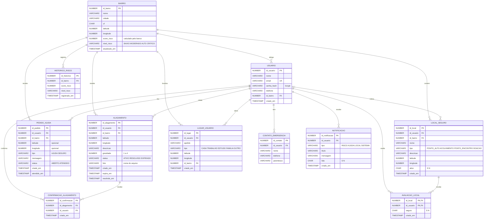

# Modelo de dados do Dilu: MER e DER

Banco: **Oracle XE 21c** (schema `ALERTA`). Os scripts estão em [`database/`](../database):
`01_schema.sql` cria as tabelas, índices e views; `02_plsql.sql` cria as funções, o package, os gatilhos e a rotina agendada.

---

## 1. MER (modelo conceitual)

O Dilu junta **moradores** que vivem em **bairros**. Os moradores **relatam alagamentos**, **confirmam** relatos
dos vizinhos, **pedem ajuda**, **indicam locais seguros**, **avaliam** esses locais e **salvam lugares** que
querem acompanhar. O sistema **avisa** os moradores e guarda o **histórico de risco** de cada bairro.

### Entidades

| Entidade | O que representa |
|---|---|
| **BAIRRO** | Região da cidade, com o nível de risco calculado pelo banco |
| **USUARIO** | Morador cadastrado no app |
| **CONTATO_EMERGENCIA** | Pessoa de confiança que o morador avisa por WhatsApp (até 5) |
| **ALAGAMENTO** | Relato de alagamento feito por um morador, com gravidade e validade |
| **PEDIDO_AJUDA** | "Preciso de ajuda" ou "Estou seguro", com ou sem localização |
| **LOCAL_SEGURO** | Ponto indicado pela comunidade (ponto alto, acolhimento, encontro, doação) |
| **LUGAR_USUARIO** | Lugar que o morador acompanha (casa, trabalho, faculdade...), até 5 |
| **NOTIFICACAO** | Aviso gerado pelo banco para um morador |
| **HISTORICO_RISCO** | Registro de cada mudança de nível de risco de um bairro |

### Relacionamentos e cardinalidades

| Relacionamento | Cardinalidade | Regra |
|---|---|---|
| BAIRRO **abriga** USUARIO | 1 : N (opcional) | O bairro do morador é descoberto pela localização do cadastro; pode ficar vazio |
| USUARIO **tem** CONTATO_EMERGENCIA | 1 : N | Máximo de 5 por morador; apagar o morador apaga os contatos |
| USUARIO **relata** ALAGAMENTO | 1 : N | Todo relato tem um autor |
| BAIRRO **recebe** ALAGAMENTO | 1 : N (opcional) | O bairro é o mais próximo do ponto, em até 15 km |
| USUARIO **confirma** ALAGAMENTO | **N : M** | Resolvido pela tabela CONFIRMACAO_ALAGAMENTO; um voto por pessoa; o autor não confirma o próprio relato |
| USUARIO **faz** PEDIDO_AJUDA | 1 : N | A localização é opcional |
| BAIRRO **recebe** PEDIDO_AJUDA | 1 : N (opcional) | Vem do ponto, ou do bairro do cadastro quando não há GPS |
| USUARIO **indica** LOCAL_SEGURO | 1 : N (opcional) | Se o morador for apagado, o local continua no mapa |
| BAIRRO **contém** LOCAL_SEGURO | 1 : N | Mais próximo do ponto indicado |
| USUARIO **avalia** LOCAL_SEGURO | **N : M** | Resolvido pela tabela AVALIACAO_LOCAL; um voto por pessoa; quem indicou não avalia |
| USUARIO **salva** LUGAR_USUARIO | 1 : N | Máximo de 5; o nome não se repete para o mesmo morador |
| USUARIO **recebe** NOTIFICACAO | 1 : N | Apagar o morador apaga os avisos |
| BAIRRO **tem** HISTORICO_RISCO | 1 : N | Uma linha por mudança de nível |

### Regras de negócio que o banco garante

- **Gravidade** de 1 a 4; **status** do relato: `ATIVO`, `RESOLVIDO` ou `EXPIRADO`.
- **Nível de risco** do bairro: `BAIXO`, `MODERADO`, `ALTO` ou `CRITICO`.
- Um relato expira em `gravidade × 3` horas; cada confirmação prolonga em 1 hora.
- Score do bairro = soma, dos relatos ativos, de `gravidade × (1 + 0,5 × confirmações)`.
- Um local seguro sai do mapa com 3 ou mais votos "não é seguro" e mais "não" do que "sim".
- Não se repete local seguro a menos de 30 m de outro ativo.

---

## 2. DER (modelo lógico, como está no Oracle)

O diagrama abaixo é desenhado em Mermaid e aparece direto no GitHub.
Uma imagem pronta está em [`DER.png`](DER.png).

### Chaves, restrições e índices

| Tabela | Chave primária | Chaves estrangeiras (ação ao apagar) | Restrições extras |
|---|---|---|---|
| BAIRRO | `id_bairro` | | `UNIQUE (nome, cidade, uf)`; `CHECK nivel_risco` |
| USUARIO | `id_usuario` | `id_bairro` → BAIRRO | `UNIQUE (email)` |
| CONTATO_EMERGENCIA | `id_contato` | `id_usuario` → USUARIO (**CASCADE**) | |
| ALAGAMENTO | `id_alagamento` | `id_usuario` → USUARIO; `id_bairro` → BAIRRO | `CHECK gravidade 1..4`; `CHECK status` |
| CONFIRMACAO_ALAGAMENTO | `id_confirmacao` | `id_alagamento` → ALAGAMENTO (**CASCADE**); `id_usuario` → USUARIO | `UNIQUE (id_alagamento, id_usuario)` |
| PEDIDO_AJUDA | `id_pedido` | `id_usuario` → USUARIO; `id_bairro` → BAIRRO | `CHECK tipo`; `CHECK status`; latitude e longitude podem ser nulas |
| LOCAL_SEGURO | `id_local` | `id_usuario` → USUARIO (**SET NULL**); `id_bairro` → BAIRRO | `CHECK tipo`; `CHECK ativo` |
| AVALIACAO_LOCAL | `(id_local, id_usuario)` | `id_local` → LOCAL_SEGURO (**CASCADE**); `id_usuario` → USUARIO (**CASCADE**) | `CHECK seguro` |
| LUGAR_USUARIO | `id_lugar` | `id_usuario` → USUARIO (**CASCADE**); `id_bairro` → BAIRRO | `UNIQUE (id_usuario, apelido)`; `CHECK tipo` |
| NOTIFICACAO | `id_notificacao` | `id_usuario` → USUARIO (**CASCADE**) | `CHECK tipo`; `CHECK lida` |
| HISTORICO_RISCO | `id_historico` | `id_bairro` → BAIRRO | |

**Índices** (além dos das chaves): `ix_alag_bairro_status`, `ix_alag_status_expira`, `ix_alag_usuario`,
`ix_conf_usuario`, `ix_pedido_bairro`, `ix_pedido_usuario`, `ix_local_bairro`, `ix_local_usuario`,
`ix_local_ativo`, `ix_lugar_usuario`, `ix_notif_usuario`, `ix_hist_bairro`.
Eles cobrem as consultas mais frequentes: relatos ativos por bairro, relatos a expirar, avisos não lidos de um morador.

### Views

| View | Para que serve |
|---|---|
| `vw_indicadores_bairro` | Painel por bairro: nível, relatos ativos, relatos em 24 h, pedidos abertos e locais seguros |
| `vw_dilu_numeros` | Números gerais do Dilu (moradores, relatos, confirmações, pedidos atendidos) |
| `vw_resumo_usuario` | Números pessoais de cada morador, usados na tela Conta |

### Normalização

O modelo está na **3ª forma normal**: cada tabela tem uma chave, e os atributos dependem só dela.
Relações N:M viram tabelas próprias (`CONFIRMACAO_ALAGAMENTO` e `AVALIACAO_LOCAL`).

Há **uma desnormalização proposital**: `BAIRRO.score_risco` e `BAIRRO.nivel_risco` poderiam ser calculados
a cada consulta, mas ficam gravados e são mantidos por gatilhos. Assim o painel lê um valor pronto em vez de
somar todos os relatos a cada abertura, e a mudança de nível gera o histórico e os avisos no mesmo instante.
