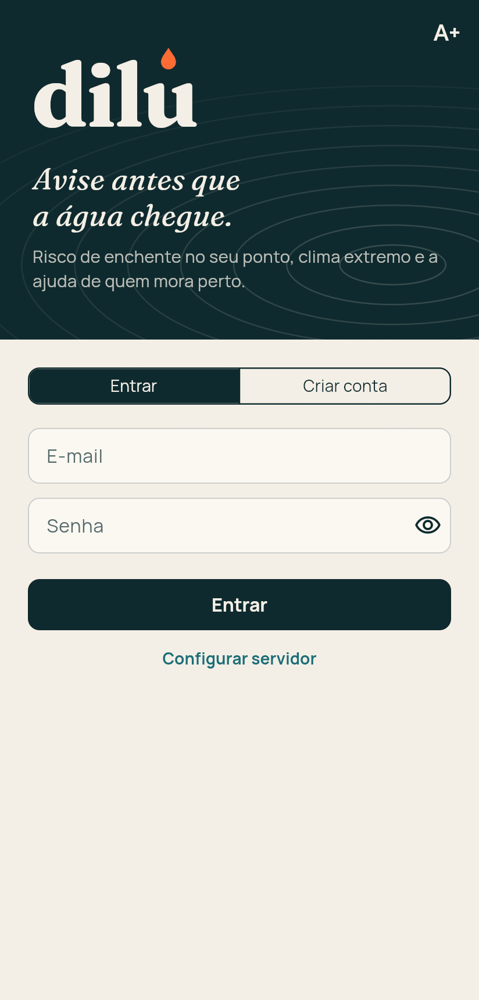
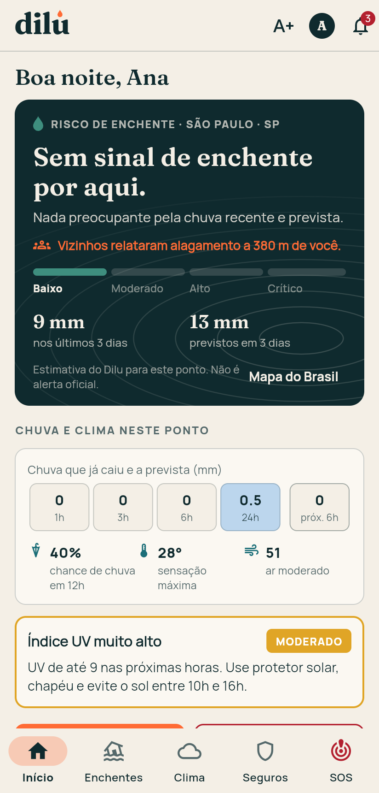
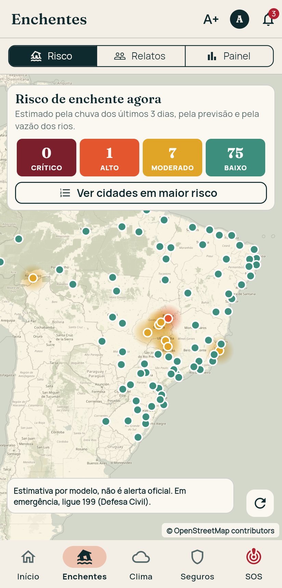
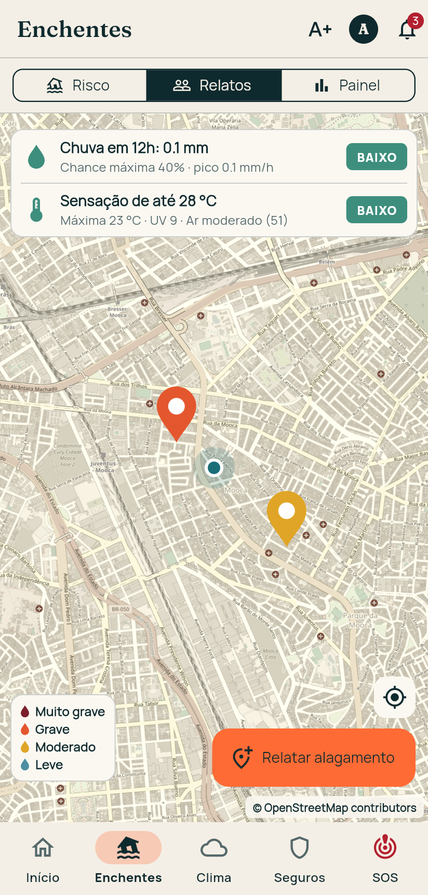
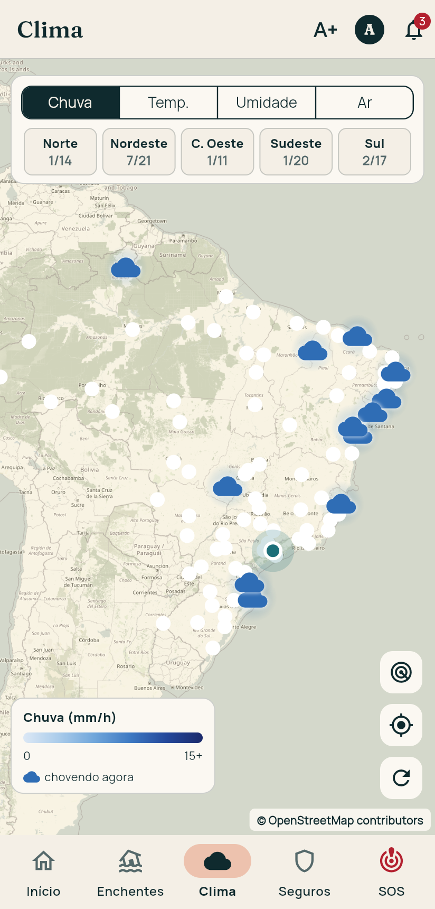
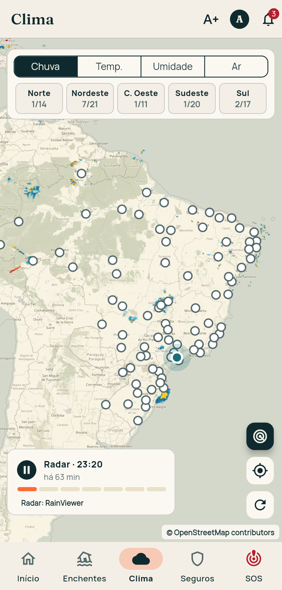
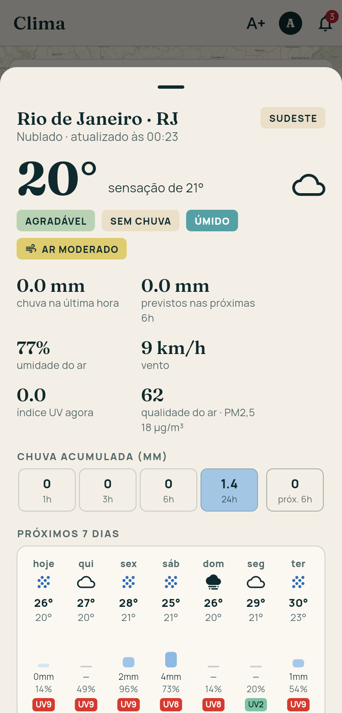
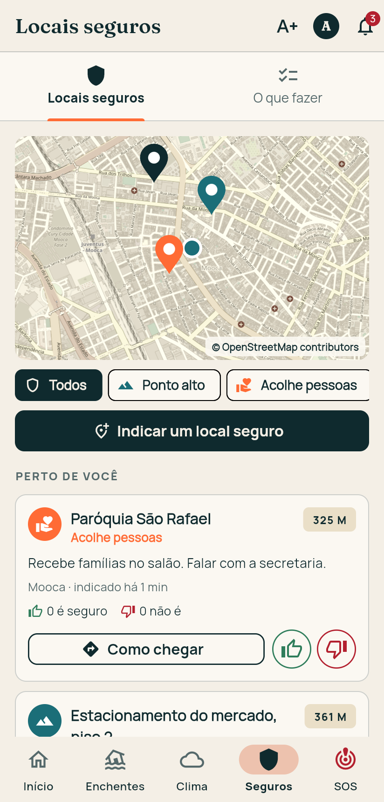
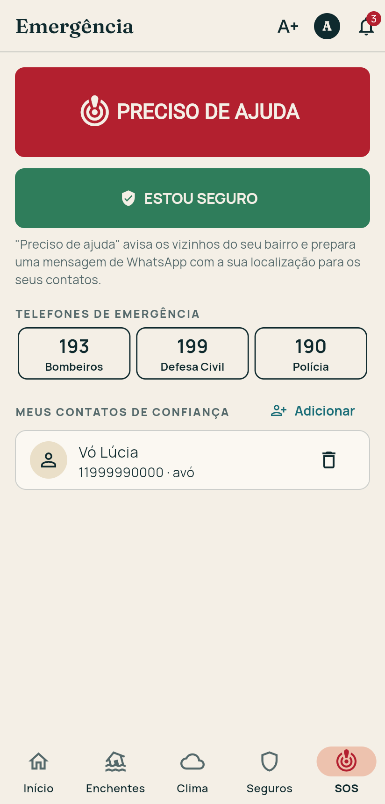
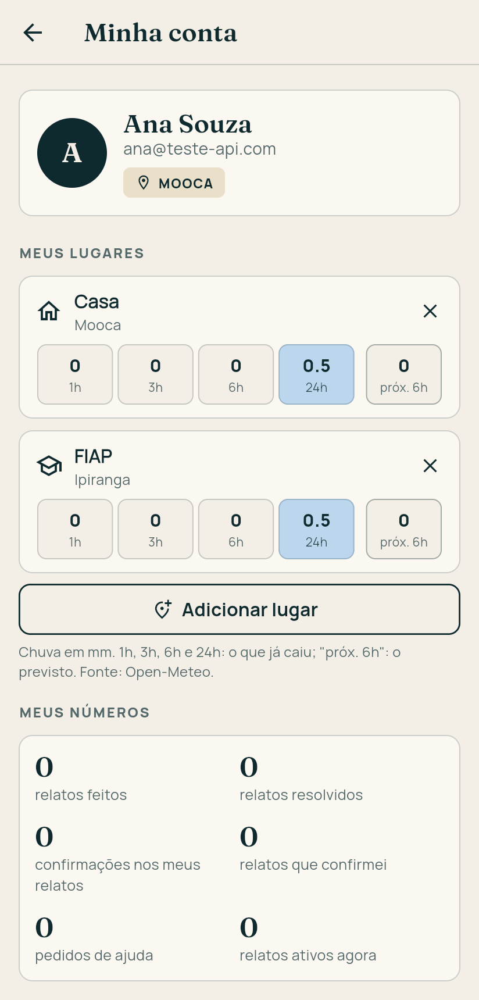

# Telas do Dilu

Prints do aplicativo rodando (Flutter na web, em formato de celular), com dados de exemplo criados só para o teste.
Os mapas usam dados do © OpenStreetMap contributors.

| | |
|---|---|
| **Entrar ou criar conta** | **Início:** risco no ponto do morador |
|  |  |
| Cadastro e entrada. Para o professor, basta "Criar conta" | Responde "estou em risco agora?" com chuva, alertas, lugares, vizinhança e kit de emergência |

| | |
|---|---|
| **Enchentes: risco por cidade** | **Enchentes: relatos da comunidade** |
|  |  |
| Risco estimado de 83 cidades (chuva dos últimos 3 dias, previsão e vazão dos rios) | Alagamentos relatados e confirmados pelos moradores; a cor do pino é a gravidade |

| | |
|---|---|
| **Clima** | **Radar de chuva ao vivo** |
|  |  |
| Chuva, temperatura, umidade e qualidade do ar, por região | Últimas 2 horas de chuva real, animadas (RainViewer) |

| | |
|---|---|
| **Ficha da cidade** | **Locais seguros** |
|  |  |
| Agora, UV, ar, chuva acumulada e previsão de 7 dias | Pontos indicados e avaliados pela comunidade |

| | |
|---|---|
| **SOS** | **Minha conta** |
|  |  |
| "Preciso de ajuda" avisa vizinhos e prepara o WhatsApp dos contatos | Meus lugares com a chuva acumulada de cada um, e números pessoais |
